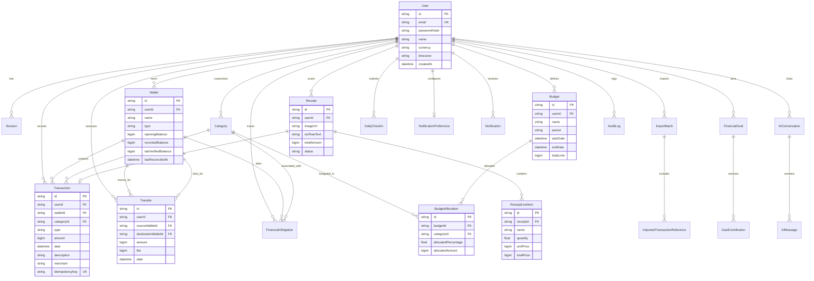

# RUPIA V2 — Entity Relationship Diagram & Architecture

This document outlines the database schema architecture for Rupia V2 personal finance intelligence engine.

## Mermaid ER Diagram

## Monetary Precision Rules
1. **Integer Rupiah Standard**: All currency fields (`amount`, `recordedBalance`, `openingBalance`, `totalLimit`, etc.) are represented as 64-bit integer values (`BigInt`) denominated in whole Rupiah (IDR).
2. **Zero Floating-Point Drift**: Addition, subtraction, balance reconciliation, and transfers never suffer IEEE-754 binary floating-point roundoff errors.
3. **Atomic Multi-Table Updates**: Transfers and balance mutations run inside Prisma transactions (`prisma.$transaction`) ensuring atomic source-decrement and destination-increment.
